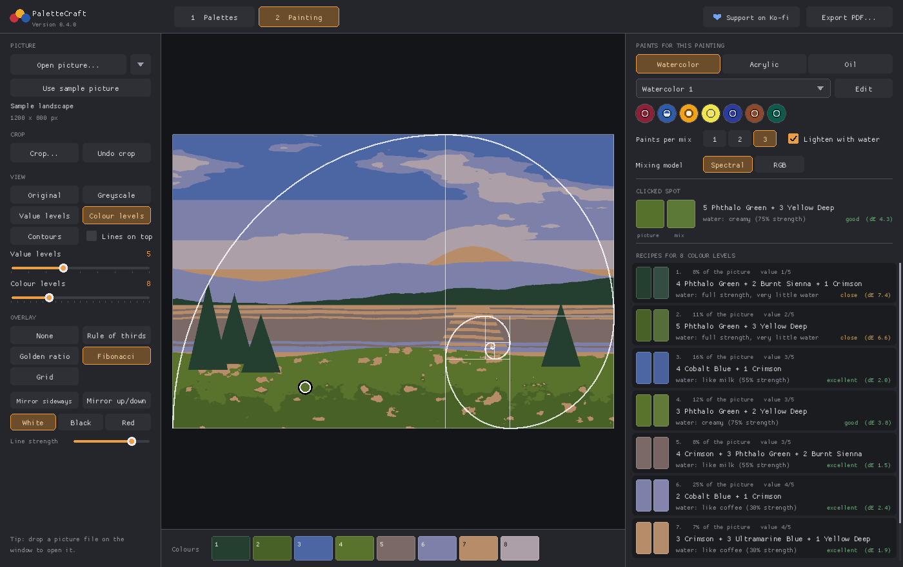

# PaletteCraft

Value studies and paint mixing recipes from a reference picture: an app for painters
planning a painting, on the desktop and in the browser. Open an image, crop it, study its
values and colours, lay a composition grid over it, and get Kubelka-Munk mixing recipes
for every colour, made from the paints in your own palettes.

**Website:** <https://skrilic.github.io/PaletteCraft/> – downloads, the web app,
[changelog](CHANGELOG.md) and [privacy policy](PRIVACY.md).



## Features

- **Palettes** – build any number of palettes (e.g. *Watercolor 1*, *Acrylic 2*). Each paint
  has a name, pigment code (e.g. `PR206`), transparency (transparent / half-transparent /
  opaque), masstone colour and tinting strength. Pick from a library of 45 common pigments
  or enter your own. Each palette shows a chart of every pair of its paints mixed.
- **Colour library** – besides the fixed general library of 45 pigments, keep your own
  colours: name, pigment(s), transparency, colour, brand (e.g. your paint maker, or
  *My colours*) and what they are for (watercolor, acrylic, oil). Add them with
  *+ New colour* or *Save to my colour library*, edit or delete them any time. Filter the
  library by brand and use, search it, and group it by brand or use.
- **Media** – watercolor, acrylic or oil. Watercolor lightens with water over paper;
  acrylic and oil lighten with white paint.
- **Picture views** – original, greyscale, value levels (2–10), colour levels (2–24) and
  contours: a line drawing of the picture's edges with adjustable detail, which can also
  be drawn on top of any other view.
- **Crop** – free or fixed aspect ratios (1:1, 4:5, 3:4, 2:3, 5:4, 4:3, 3:2, 16:9), with undo.
- **Composition overlays** – rule of thirds, golden ratio grid (lines at 38.2% and 61.8%),
  Fibonacci spiral (mirrorable) or a square grid
  with optional diagonals and cell labels.
- **Recently opened** – the arrow beside *Open picture...* lists the last 10 pictures,
  so you can go back to an earlier painting in one click. Each picture remembers its own
  settings (crop, views, levels, overlay, paint type and palette, paints per mix, mixing
  model, mix or glaze, clicked spot), which come back whenever you open it again. The × beside a picture removes it
  from the list, with its settings.
- **Mixing recipes** – every colour level gets a recipe such as
  *"4 Cobalt Blue + 2 Crimson + 1 Yellow Deep, water: like coffee"* with a match rating
  (excellent / good / close / rough, by colour difference dE); hover the rating for an
  explanation. Click anywhere on the picture to get a recipe for that spot.
- **Spectral mixing** – by default each paint's colour is turned into a smooth reflectance
  curve and mixed wavelength by wavelength (spectral Kubelka-Munk, 31 bands from 400 to
  700 nm), which behaves more like real paint: a red and its complementary green
  neutralise to grey, a red with a blue leans violet. The *Mixing model* switch goes back
  to the simpler RGB model for comparison.
- **Glazing** – the *Method* switch (*Mix* / *Glaze*) turns the recipes into layers
  instead of mixtures: a first layer (a watercolor wash, or for acrylic and oil one paint
  with white, or the white ground), then up to two glazes of transparent or
  half-transparent paints, e.g. *"Cobalt Blue, then Crimson, then Lemon Yellow"* with the
  strength of each layer. Small chips beside each recipe show the colour after each layer.
- **Export PDF** – the *Export PDF...* button saves a reference brochure (A4) with the
  original picture, the value study with its percentages, the contour drawing, the chosen
  palette with its mixing chart, and a recipe for every colour level using the chosen
  number of paints per mix, followed by a legend of the match ratings. You pick the file
  name and folder.

Palettes are saved automatically to
`<config dir>/PaletteCraft/palettes.json`
(on Linux `~/.config/PaletteCraft/palettes.json`), and the recently opened
pictures with their settings to `recent.json` in the same folder.

## Support

If the app helps your painting, you can leave a tip – thank you!

[](https://ko-fi.com/Q6X32AWI41)

The app has the same link: *Support on Ko-fi* in the top bar (on a phone, at the bottom of
the *Palettes* pane).

## Updates

The top bar shows the app's version under its name. Click the name (on a phone, the logo)
to see whether a newer version is out: the app then asks GitHub for the latest release,
and offers its download page (the web app reloads with the new version instead). It does
not check on its own.

## Download

**Phones, tablets and any browser:** open the web app at
<https://skrilic.github.io/PaletteCraft/app/> and install it from the browser
(Safari: *Share → Add to Home Screen*; Chrome: *Install app*). It works offline once opened.

Ready-made builds for Linux, macOS and Windows are on the
[Releases](https://github.com/skrilic/PaletteCraft/releases) page, with
installation notes for each system.

On Linux, run `./install.sh` in the unpacked folder to add the app to your applications
menu (installs to `~/.local`; `./install.sh --uninstall` removes it).

## Building and running

Requires a recent stable Rust toolchain (the crate uses edition 2024).

```sh
cd app
cargo build
cargo run                       # start the app
cargo run -- path/to/photo.jpg  # start with a picture open
```

### Web version

The same app also runs in a web browser (WebAssembly):

```sh
rustup target add wasm32-unknown-unknown
cd app
./web/build.sh                              # builds into target/web/
python3 -m http.server -d target/web 8080   # then open http://localhost:8080
```

The web build is an installable web app (PWA): `manifest.webmanifest` and icons in
`app/web/`, and a service worker (`sw.js`) that keeps the app's files so it starts offline.
Each build names its cache after a hash of the files, so installed copies update on their
next start after a new version is published.

In the browser, *Open picture...* uses the browser's file chooser (on phones and tablets:
photos, camera or files), *Export PDF...* downloads the brochure, and palettes are kept in
the browser's local storage. A browser cannot open a file again by its path, so the web app
keeps a copy of each picture in its recently opened list (the last 10) in the browser's
IndexedDB; *Clear recent list* deletes them.

On a narrow screen (a phone, or a tablet held upright) the app shows one pane at a time,
chosen in a bar under the top bar: *Picture*, *Adjust* and *Recipes* on the Painting
screen, *Palettes*, *Paints* and *Edit & library* on the Palettes screen. Tap the picture
to get a recipe for that spot; it appears under the picture. Drag lists and panes to
scroll them, and tap a match rating (e.g. *good*) to see what it means. The desktop app
switches to the same layout when its window is made narrower than 900 pixels.

No system development packages are needed to build on Linux:
[miniquad](https://github.com/not-fl3/miniquad) loads libX11/libXi/libGL (or the Wayland
and EGL libraries) at runtime, and any desktop install already has them.

You can open a picture three ways: the **Open picture...** button, dragging a file onto
the window, or passing its path on the command line. Supported formats: PNG, JPEG, WebP,
BMP and TIFF.

### Command-line options

| Option | Effect |
|---|---|
| `<path>` | Open this picture on start |
| `--palettes` | Start on the Palettes screen |
| `--window <W>x<H>` | Window size, e.g. `390x780` to see the phone layout |
| `--view <name>` | With `--screenshot`: show only that view (`original`, `grey`, `values`, `colours`, `contours`), without overlay or clicked spot |
| `--pane <0-2>` | In the phone layout, which pane to show (for screenshots) |
| `--screenshot <file.png>` | Render the Painting screen with a built-in sample landscape, save a PNG and exit |
| `--self-test <file.json>` | Drive the app with scripted input, write step results as JSON and exit |

`--screenshot` and `--self-test` use default palettes and never touch your saved ones.

## Testing

```sh
cd app
cargo test                                   # unit tests for the mixing model
cargo run -- --self-test shots/selftest.json # end-to-end UI test
```

The self-test always exits with status 0; check that every step in the JSON file has
`"passed": true`.

## Making a release

Releases are built by [.github/workflows/release.yml](.github/workflows/release.yml):

1. Set `version` in `app/Cargo.toml` (e.g. `0.2.0`), commit and push.
2. Tag and push: `git tag v0.2.0 && git push origin v0.2.0`.

The workflow builds a Linux `.tar.gz`, a universal macOS `.app` (zipped) and a Windows
`.zip`, then publishes a GitHub release with checksums and the notes from
[packaging/release-notes.md](packaging/release-notes.md). The tag must match the Cargo
version or publishing stops. Running the workflow by hand from the Actions tab builds the
packages without publishing them.

The builds are not code-signed or notarised.

### App icon

The icon sources are SVGs in [packaging/icon](packaging/icon): `icon.svg` for 64 px and
up, and simplified `icon-32.svg` / `icon-16.svg` for small sizes. After editing them,
regenerate every format (needs Inkscape and Pillow) and commit the results:

```sh
python3 packaging/icon/make_icons.py
```

This writes `app/assets/` (window icon PNGs and the Windows `.ico`) and
`packaging/icon/` (`AppIcon.icns` for macOS, `icon-256.png` for Linux).

## How the colour mixing works

Mixing uses two-constant Kubelka-Munk theory per RGB channel in linear light. Each paint's
absorption (K) and scattering (S) are derived from its masstone colour and transparency;
mixtures add K and S weighted by parts and tinting strength.

- **Watercolor** – the paint film sits on paper; less pigment (more water) lets the paper
  show through.
- **Acrylic / oil** – an opaque body; lighter values come from adding white.

The best recipe for a target colour is found by searching single paints, pairs (1–6 parts
each) and triples (1–4 parts each), ranked by CIE76 colour difference (ΔE) with a small
penalty for every extra paint.

Pigment colours and the model constants are estimates, not measurements. Every tunable
value and where it came from is listed in [app/MECHANICS.md](app/MECHANICS.md) (also as
[app/mechanics.json](app/mechanics.json)).

## Project layout

```
app/
  src/
    main.rs           entry point, command-line options, screenshot
    app.rs            app state, shared drawing helpers
    app/painting_view.rs   Painting screen
    app/palettes_view.rs   Palettes screen
    app/update_view.rs     "About" dialog with the update check
    colour.rs         sRGB / linear / CIE Lab conversions, ΔE
    km.rs             Kubelka-Munk model and recipe search
    imgproc.rs        loading, cropping, value levels, k-means colour levels
    grid.rs           composition overlays
    palette.rs        paints, palettes, pigment library, saving
    ui.rs             small immediate-mode UI toolkit
    selftest.rs       scripted end-to-end test
    update.rs         asks GitHub for the latest version
  assets/             generated icon files embedded in the app
  build.rs            embeds the icon in the Windows .exe
  vendor/miniquad/    patched copy of miniquad 0.4.11
  MECHANICS.md        all model and UI constants with their source
  shots/              reference screenshots and self-test output
```

### Vendored miniquad

`app/vendor/miniquad` is miniquad 0.4.11 with local changes, wired in through
`[patch.crates-io]` in `app/Cargo.toml`:

- `MINIQUAD_NO_ACTIVATE` env var (macOS): open the window without taking focus. The app
  sets it for `--screenshot` and `--self-test` runs.
- Fixed two compiler warnings: `set_or_replace_display` is now Android-only, and the X11
  clipboard buffer is a `Mutex` instead of a `static mut`.

## Ideas for later

- Spectral Kubelka-Munk for more accurate mixes
- Glazing (layering transparent paints)
- Export of a printable recipe sheet
- Remember the last picture between sessions

## Licence

Licensed under either of

- Apache License, Version 2.0 ([LICENSE-APACHE](LICENSE-APACHE))
- MIT licence ([LICENSE-MIT](LICENSE-MIT))

at your option.

Unless you explicitly state otherwise, any contribution intentionally submitted for
inclusion in this project by you, as defined in the Apache-2.0 licence, shall be dual
licensed as above, without any additional terms or conditions.

The vendored miniquad in `app/vendor/miniquad` keeps its own MIT / Apache-2.0 licence files.
